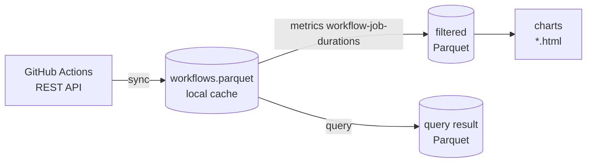
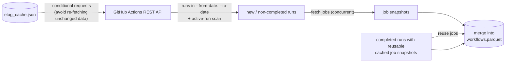
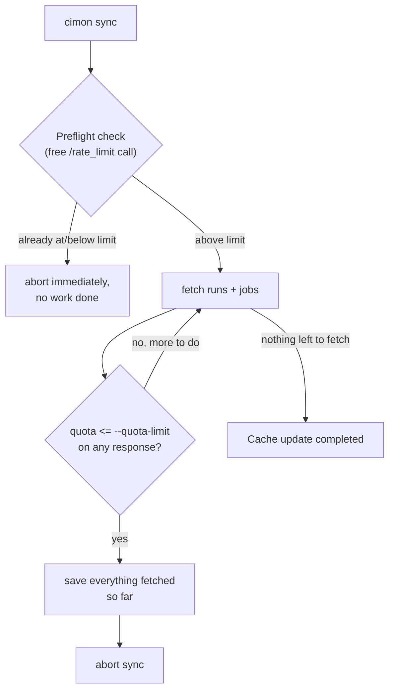
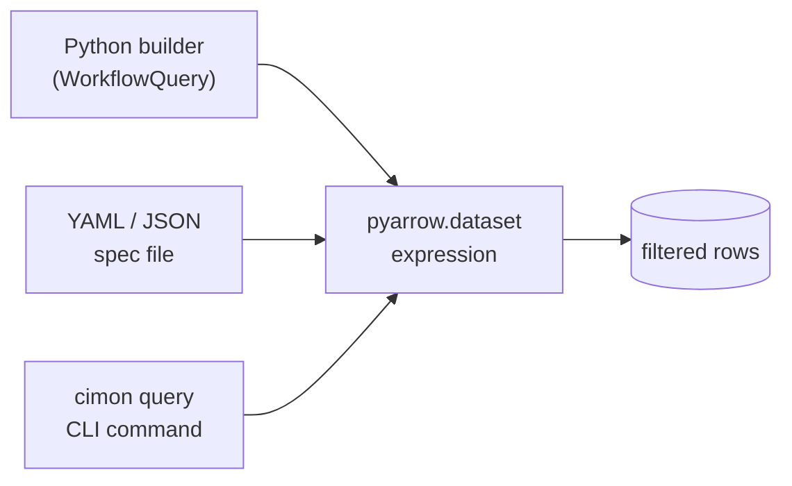
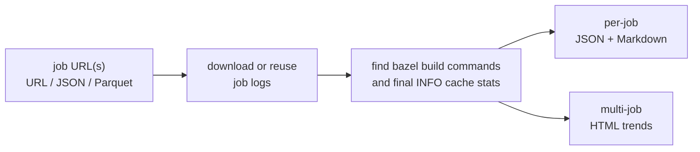
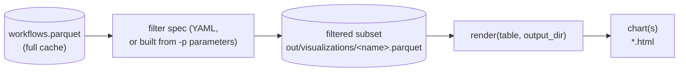
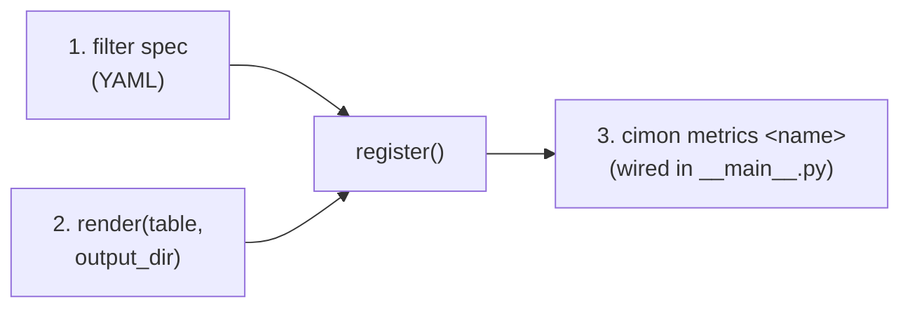

# cimon

Small CLI tool for tracking github action workflow runs related data.

## Prerequisites

- Python 3.10 through 3.13 and [uv](https://docs.astral.sh/uv/) for the examples below.
- For `sync`, `quota` and `runners`: `GH_HOST` (or `--host`) and a matching
  `.netrc` / `$NETRC` entry or `GH_TOKEN` / `GITHUB_TOKEN` (or `--token`).
- For downloading logs and extracting build metrics: the GitHub CLI `gh` and
  credentials for the job URL's host.
- SQL queries additionally require the optional `viz` dependency, e.g.
  `uv run --extra viz cimon query ...`. The Plotly visualizations themselves
  use standard dependencies.

For development, [Commitizen](https://commitizen-tools.github.io/commitizen/)
and [pre-commit](https://pre-commit.com/) are included in the uv `dev` group.
[actionlint](https://github.com/rhysd/actionlint) is an optional, separately
installed tool for checking GitHub Actions workflows locally; it is not a
Python dependency.

For development, [Commitizen](https://commitizen-tools.github.io/commitizen/)
and [pre-commit](https://pre-commit.com/) are included in the uv `dev` group.
[actionlint](https://github.com/rhysd/actionlint) is an optional, separately
installed tool for checking GitHub Actions workflows locally; it is not a
Python dependency.

The [DuckDB Sidekick](https://marketplace.visualstudio.com/items?itemName=PrasertKana.duckdb-sidekick&utm_source=chatgpt.com)
VS Code extension is optional and useful for inspecting Parquet files.

### Dependency Resolution

The project prioritizes [PyPI](https://pypi.org/simple) for dependency
resolution, and `uv.lock` records the resolved package sources. uv also merges
user and system configuration: additional indexes configured there can still
be consulted as fallbacks. Environment variables and command-line options can
override project settings.

To prefer a JFrog index configured in your user or system uv configuration,
comment out the entire `[[tool.uv.index]]` PyPI block in `pyproject.toml`.
To switch back, uncomment it. This changes resolution priority, but existing
`uv.lock` entries still point to their original sources. To update the
lockfile, run `uv lock --upgrade`, then review the resulting source and version
changes: this can also upgrade dependencies. The changed lockfile applies to
everyone using the repository; JFrog must be configured and reachable where
it is used.

### Pull request tests

The [PR workflow](.github/workflows/pr.yml) runs the full test suite when a
pull request is opened, reopened, or updated with commits. It tests GitHub's
PR merge commit with Python 3.12, including the `viz` extra. To require the
tests before merging, configure `cimon full test suite` as a required status
check in the repository's ruleset or branch protection rules.
The `cimon workflow lint` check runs actionlint on all workflow files and can
also be configured as a required status check.

### Commit convention

Use [Conventional Commits](https://www.conventionalcommits.org/) for commit
messages, for example `feat: add metrics export` or `fix: handle missing jobs`.
Mark breaking changes with `!`, for example `feat!: change output format`, or
with a `BREAKING CHANGE:` footer. Commitizen uses these messages to determine
version changes and generate changelog entries; changes without a recognized
conventional message may not be reflected in the version or changelog.

The automatic workflow starts a bump only when it finds a `feat`, `fix`, or
breaking change since the current version tag. Other types such as `docs` or
`refactor` alone do not trigger it. For squash merges, ensure the final squash
commit message follows the convention.

The PR workflow checks every commit reachable from the PR head but not the
base using Commitizen. Configure `cimon conventional commits` as a required
status check in the repository's ruleset to enforce this before merging.

To check commit messages locally before Git creates a commit, install the
pre-commit hook from the checkout root:

```bash
uv run --locked pre-commit install
```

The hook uses Git's `commit-msg` stage, when the message is available. If this
checkout previously used the old `.githooks` setup, remove that specific
configuration first with `git config --local --unset core.hooksPath`; review
any other custom hooks before changing their configuration. The hook runs
outside Bazel because it is invoked by Git and uses the dev dependencies
resolved by uv from the configured indexes. It can be bypassed with
`git commit --no-verify`. To check existing commits locally, fetch the base
branch and run:

```bash
uv run --locked cz check --rev-range origin/main..HEAD
```

To lint workflow files locally after installing actionlint:

```bash
actionlint
```

### Automatic version bumps

The [version-bump workflow](.github/workflows/version-bump.yml) runs after a
push to `main`. It first checks every commit since the current version tag
with Commitizen, including squash commits. A validation failure stops the
workflow without creating a tag. If there is a `feat`, `fix`, or breaking
change, it then runs the test suite on the checked-out `main` commit, including
the `viz` extra. Only if the tests pass does Commitizen update the version,
lockfile and changelog and push the bump commit and `v<version>` tag together.
If there are no qualifying commits, no tag is created. Concurrent pushes can
be included in the same bump.

If a commit message is invalid, inspect the workflow log and coordinate the
correction with collaborators before rewriting shared `main` history. An
authorized user must correct the affected commits after the current version
tag and push the rewritten branch, using any necessary temporary ruleset
bypass. Do not rewrite or move the current version tag. Verify the corrected
range with `uv run --locked cz check --rev-range v<version>..HEAD` before
pushing; use `git push --force-with-lease` rather than an unconditional force
push, then restore protections and confirm the new workflow run succeeds.
History rewriting changes commit IDs and requires collaborators to synchronize
their branches. Check the failure output first: not every validation failure
is caused by an invalid message.

The workflow uses a GitHub App installation token to push the bump commit and
tag. To configure it:

1. Create a GitHub App with repository **Contents: read and write** permission,
   install it only on this repository, and generate a private key.
2. Add the App ID as the repository Actions variable `CIMON_BUMP_APP_ID` and
   the complete private key as the Actions secret `CIMON_BUMP_APP_PRIVATE_KEY`.
   Keep the private key out of the repository and chat.
3. Add the app to the bypass list of every applicable `main` ruleset with
   direct-push bypass permission. Also allow it through any applicable branch
   protection and tag rules. This grants the app the ability to bypass those
   protections, so limit access to its private key.

The workflow creates a repository-scoped token only after the tests pass.
A competing push can cause the atomic push to fail; a later workflow run
processes the updated `main`. The App push triggers another workflow run,
which sees the current commit is already tagged and does nothing. No GitHub
Release is created.

### Creating a pull request

Install the GitHub CLI and authenticate with `gh auth login`. From a cimon Git
checkout, commit your changes on a feature branch, then run:

```bash
gh pr create --template pull_request_template.md
```

The [PR template](.github/pull_request_template.md) must be present on the
repository's default branch. `gh` uses the current branch and guides you
through creating the pull request, offering to push the branch if needed.
Fill in the summary, changes, and validation commands and results.

For squash merges, use a Conventional Commit PR title such as
`feat: add metrics export` so the resulting commit can trigger the automatic
version bump when appropriate.

## Purpose

`cimon` helps to track a repository's GitHub Actions workflow runs over time. Rather than clicking through the
GitHub Actions UI run by run, it collects workflow-run and job history into a local, queryable cache
and builds tooling on top of it:

- **Caching** -- incrementally sync workflow runs and jobs from the GitHub
  API into a local Parquet cache, without re-fetching data that hasn't
  changed.
- **Querying** -- filter that cache declaratively (Python API, YAML/JSON spec
  files, SQL, or the `query` CLI command) to answer questions like "which jobs
  failed in the last week" or "which runners are currently busy".
- **Visualizing** -- turn filtered cache data into charts (workflow-run job
  durations) through a small, pluggable rendering pipeline. Build metrics and
  live runner status also have separate HTML visualizations.

The workflow-duration visualization filters the cache and writes both a
Parquet subset and HTML charts. Other commands can query the cache, process
job logs, or fetch live runner status independently:



### Caching

`cimon sync` fetches GitHub Actions workflow-run and job data via the GitHub
REST API and persists it into a local, append/merge-able Parquet cache
(`workflows.parquet`, one row per run **and** job -- see
[Querying the workflows cache](docs/references/workflow-query.md) for the
row layout). Every other feature that works with workflow-run data (`query`,
`metrics`, `cache-info`) reads from this cache, not the API directly.



To keep repeated syncs fast and light on the API quota:

- Completed runs with terminal cached jobs, creation timestamps and a cached
  snapshot for the current attempt are reused without re-fetching their jobs.
  New or active runs and incomplete or outdated job snapshots are fetched.
- An **ETag cache** (`etag_cache.json`) makes conditional GET requests, so
  unchanged pages return `304 Not Modified` instead of a full payload.
- A separate **active-run scan** (independent of `--from-date`/`--to-date`)
  discovers active runs outside the requested date range, subject to API
  pagination limits. Cached active runs missed by both scans are also
  reconciled individually.
- When reconciling a previously active run returns HTTP 404, its cached active
  workflow status is marked `unavailable` and its job data is preserved. The
  run may have been deleted or may no longer be accessible to the credentials.
  A later listing can refresh it if it becomes visible again.

Everything above is merged into `workflows.parquet` under `--cache-dir`
(default `~/.cache/cimon`), alongside `response.json` (a snapshot of just the
last sync request, not the cumulative cache) and `etag_cache.json`.

#### Example: updating the cache

```bash
uv run cimon sync --workflow pr.yml --from-date 2026-08-01 --to-date 2026-08-31 --cache-dir .
```

`sync` defaults to owner `CAS`, repository `app-adas-src` and today's UTC date
for both date boundaries; use `--owner`, `--repo`, `--from-date` and `--to-date`
to change them.

Repeat `--workflow` to sync several workflow files in one invocation:

```bash
uv run cimon sync --workflow pr.yml --workflow cas_nightly_and_release.yml
```

Workflows are processed sequentially and merged into the same Parquet cache.
They share the API session, quota limit and ETag cache. `response.json` remains
a snapshot of the last processed workflow, not a combined response. If the quota
limit is reached, fetched data is saved and remaining workflows are not processed.

```bash
Fetching workflow runs ... done (303 runs found)
Workflow runs requiring job update: 12
Cache update completed.
ETag cache:   etag_cache.json (4.1 KB)
GH Response:  response.json (128.4 KB)
    Runs:     303 (2 new, 301 known)
Cache:        workflows.parquet (598.0 KB)
```

Inspect the resulting cache without re-fetching anything:

```bash
uv run cimon cache-info --cache-dir .
```

```bash
Parquet cache: workflows.parquet (598.0 KB)
      .github/workflows/pr.yml (303 RUNS)
      .github/workflows/gitlint.yml (331 RUNS)
      .github/workflows/qg_cas_build_and_test.yml (645 RUNS)
      ...
```

To keep every workflow that's actually triggered on pull requests up to
date in one go, see
[`scripts/sync.sh`](scripts/sync.sh), which
loops `cimon sync` over every workflow file referencing `pull_request`/
`merge_group` and defaults to today's date. This helper uses the hard-coded
workspace and host in the script and waits for a keypress on exit.

#### Edge case: negative `job_duration_sec`

For jobs that never actually ran (mostly `skipped`, occasionally
`cancelled`), GitHub's API can report `completed_at` a few seconds *before*
`started_at`, which would otherwise yield a negative `job_duration_sec`.
`cimon` clamps this to `None` instead. Because "completed runs whose jobs
are already cached are reused" (see above), a run whose jobs were synced
before this clamp existed keeps a stale, wrong value in
`workflows.parquet` until that run's jobs are rebuilt from their cached
`started_at`/`completed_at` -- which happens automatically the next time the
run is synced (no extra API calls needed), but only for runs within the
sync's requested date range / active-run scan.

To fix already-cached, out-of-range history in one go without touching the
GitHub API, run:

```bash
uv run cimon repair-cache --cache-dir .
```

To remove a created-at range from a cache before re-syncing, preview it first
with `prune-runs --dry-run`. Without `--dry-run`, matching rows are removed
from the specified Parquet file in place:

```bash
uv run cimon prune-runs workflows.parquet --from-date 2026-08-01 --to-date 2026-08-31 --dry-run
```

`--to-date` is required; omitted `--from-date` defaults to `0001-01-01`.
Both boundaries are inclusive and also accept ISO-8601 timestamps.

#### Quota

Since every sync consumes GitHub API quota, check how much is left (reads
`GH_TOKEN`/`GITHUB_TOKEN` and `GH_HOST` from the environment, same as `sync`
(a matching `~/.netrc` entry for the host takes precedence over the token)):

```bash
uv run cimon quota
```

Use `uv run cimon quota --json` for a machine-readable object with `limit`,
`used`, `remaining` and `reset` (Unix timestamp).

```bash
GitHub API quota:
  Limit:     15000
  Used:      342
  Remaining: 14658
  Reset:     2026-08-31 16:00:00+00:00
```

#### Aborting a sync before quota runs out

The same token is often shared with other tools/scripts (e.g. other CI jobs,
or someone using the GitHub web UI), and GitHub also enforces secondary/abuse
rate limits independent of the plain remaining-count. Running a sync all the
way down to 0 remaining requests is therefore riskier than necessary, and
what quota is "safe" to leave as a buffer differs per environment (GitHub
Enterprise Server instances can configure their own, often lower, limits).

`cimon sync` accepts `--quota-limit N` to stop once the remaining quota
drops to/below `N`, instead of running until the API itself starts rejecting
requests:

```bash
uv run cimon sync --workflow pr.yml --from-date 2026-08-01 --quota-limit 200
```

If `--quota-limit` isn't given, it defaults to 10% of the token's actual rate
limit ceiling (e.g. `500` for a `5000`-limit token, `1500` for `15000`) --
picked up automatically from `/rate_limit`, so every sync stays protected
without requiring opt-in. Pass an absolute `--quota-limit` to override this.

This is checked twice:



- **Before** any work starts (a free `/rate_limit` check that doesn't itself
  consume quota), so a sync that's already doomed fails fast instead of
  fetching workflow runs first.
- **During** the sync, after every API response -- since a single sync can
  consume far more quota than expected (e.g. an unusually busy day). Runs and
  jobs already fetched at that point are still saved to the cache before the
  sync aborts, so nothing already fetched is wasted -- the next sync picks up
  where this one left off (any run left without jobs is simply re-fetched,
  since it isn't recognized as "complete" yet).

### Querying

Once `workflows.parquet` is populated, filter it down to answer questions
like "which jobs failed in the last week" or "which runners are currently
busy". Filters can be expressed as Python, YAML/JSON, or CLI spec files;
these compile to `pyarrow.dataset` expressions. The CLI also supports a
separate DuckDB SQL mode.



- a fluent Python builder (`WorkflowQuery`), for ad-hoc use in scripts/notebooks;
- a declarative YAML/JSON **spec file** for a saved or dynamically supplied
  filter;
- the `cimon query` CLI command, which applies one or more spec files to a
  Parquet cache and writes the filtered rows to a new Parquet file. Multiple
  specs are AND-combined.

#### Example: filtering with a spec file

```yaml
# tests/example_specs/filter_by_job_name.yml
all:
  - column: job_conclusion
    op: eq
    value: success
  - column: job_name
    op: contains
    value: "Disk Cleanup"
  - column: job_started_at
    op: gt
    value: "2026-09-18"
```

```bash
uv run cimon query tests/example_specs/filter_by_job_name.yml -i workflows.parquet -o out/filtered.parquet
```

```text
Wrote <count> filtered row(s) to out/filtered.parquet
```

Add `-c/--column` (repeatable) to restrict the output to specific columns,
e.g. `-c run_id -c job_name -c job_duration_sec`.

#### Example: querying with SQL

SQL mode requires DuckDB (the `viz` extra). The file must contain exactly
one SELECT statement, with the input Parquet exposed as `source`:

```bash
uv run --extra viz cimon query \
  --sql-file tests/example_specs/filter_build_workflows.sql \
  -i workflows.parquet -o out/build-workflows.parquet
```

SQL mode cannot be combined with spec files or `--column`, and the input and
output paths must differ.

#### Example: filtering from Python

```python
from cimon.workflows.query import WorkflowQuery

rows = (
    WorkflowQuery("workflows.parquet")
    .job_status("in_progress")
    .runner_label("app-adas-src")
    .columns("run_id", "job_name", "job_runner_labels")
    .to_pylist()
)
```

Each row normally represents one **job** belonging to one **run** (run-level columns like
`run_id`/`workflow_status`/`created_at` repeat across every job row of that
run). A run with no cached jobs has a row with null job fields. See
[Querying the workflows cache](docs/references/workflow-query.md) for the
full row layout, the complete list of supported operators (`eq`, `between`,
`contains`, `list_contains`, ...), and more `WorkflowQuery` examples.

## Features

### Build metrics

`cimon metrics build-metrics` extracts Bazel build duration and cache-hit information
from GitHub Actions job logs. It accepts one of three input forms:

- a single GitHub Actions job URL;
- a JSON array containing `{"job": {"job_url": ...}}` entries;
- a Parquet file with a `job_url` column, typically produced by `cimon query`.

These three input forms (URL / JSON array / Parquet file) are also accepted
by `cimon download-logs` (see [Download logs](#download-logs) below); both
commands use the same log downloader. To reuse logs between them, pass
`download-logs`'s `OUTPUT_DIR/logs` as the `build-metrics` output directory.
Their JSON form differs though:
`download-logs` only needs job URLs, so it takes a plain array of URL
strings instead of `build-metrics`' `{"job": {...}}` entries.

For Parquet input, an optional `job_runner_name` column is carried into the
runner comparison chart. The command uses `gh api`, so GitHub CLI must be
installed. Credentials are selected for each URL's host: a matching `~/.netrc`
(or `$NETRC`) entry takes precedence over environment tokens; otherwise `gh`'s
saved login can be used. The same applies to `download-logs`.



For each `bazel build` invocation, Cimon records its targets, Bazel configs,
duration, and the raw Bazel process-strategy counts (`action cache hit`,
`remote cache hit`, `internal`, `processwrapper-sandbox`, `local`). From those
counts it derives three ratios (see [Cache-hit metrics](#cache-hit-metrics)
below) instead of a single "cache-hit rate", because a combined local+remote
rate cannot tell a specific runner's own cache health apart from the shared
remote cache.

#### Cache-hit metrics

Bazel reports each build's processes under one of five strategies: `action
cache hit` (this runner's own on-disk/incremental cache), `remote cache hit`
(the shared remote cache), `internal` (bookkeeping, e.g. symlinks -- never a
cache candidate), and `processwrapper-sandbox`/`local` (both: a real
execution on this runner). Cimon derives three ratios from these counts:

| Metric | Formula | What it tells you |
|---|---|---|
| `hit_rate` | `(action + remote) / (action + remote + internal + local + sandbox)` | Overall build-level cache effectiveness. **Not** a runner signal: `remote` is shared and `internal` dilutes it. |
| `local_cache_effectiveness` | `action / (action + local + sandbox)` | Of the processes *not* covered by the shared remote cache, the share this runner's own cache already had. This is the actual runner-quality signal. |
| `executed_share` | `(local + sandbox) / (action + remote + local + sandbox)` | Share of non-internal processes this runner genuinely executed; includes remote hits in the denominator. |

`local_cache_effectiveness` is `None` (shown as `n/a` in the per-build
Markdown table) when there are no local hits or executions, e.g. a build
entirely resolved by the remote cache. `executed_share` is `None` only when
there are no non-internal processes; for a remote-cache-only build it is zero.

#### Example: one job

```bash
uv run cimon metrics build-metrics \
  https://cariad.ghe.com/CAS/app-adas-src/actions/runs/281903722/job/1159770792 \
  out/build-metrics
```

#### Example: jobs selected from the workflow cache

First create a Parquet file containing the build jobs of interest, including
`job_url` and optionally `job_runner_name`. Then process all selected jobs:

```bash
uv run cimon query tests/example_specs/filter_build_jobs.yml \
  -i workflows.parquet \
  -o build_jobs.parquet \
  -c job_url \
  -c job_runner_name

uv run cimon metrics build-metrics build_jobs.parquet out/build-metrics
```

For non-empty Parquet or JSON input, the output is organized by workflow run
and job ID with aggregate charts at the output root. Missing runner names are
grouped as `(unknown)`:

```text
out/build-metrics/
├── 281903722/
│   ├── 1159770792.log
│   ├── 1159770792.json
│   └── 1159770792.md
├── cache-hit-rate-trend.html
├── runner-cache-health.html
└── runner-cache-trend.html
```

- `<job_id>.log` is the downloaded GitHub Actions log.
- `<job_id>.json` contains the structured job and build metrics.
- `<job_id>.md` contains a readable per-build table with the source log lines.
- `cache-hit-rate-trend.html` plots hit rate and duration over time, one line
  per Bazel config (hover shows the targets built together in that
  invocation).
- `runner-cache-health.html` compares `local_cache_effectiveness`, `hit_rate`,
  and `executed_share` distributions between runners (see
  [Cache-hit metrics](#cache-hit-metrics)), plus a runner x time-bucket
  heatmap of `local_cache_effectiveness` below the box plots -- one row per
  runner, so it stays readable with many (often short-lived) runners, unlike
  a line-per-runner time series.
- `runner-cache-trend.html` shows the same three metrics over time, one color
  per runner. Click runner names in the legend to isolate specific runners.
  The top `local_cache_effectiveness` panel is the relevant view for
  runner-specific cache warming and degradation.

Use the same output directory on repeated calls to avoid downloading logs
again. Existing non-empty logs are reused, while new downloads are first
written to a temporary `.log.part` file and only moved into place after a
successful download. JSON and Markdown are regenerated from the cached logs;
Parquet or JSON input also generates aggregate HTML. A single URL does not
generate aggregate charts. If no output directory is given, it defaults to
`/tmp`.

### Download logs

`cimon download-logs` downloads job log(s) into
`OUTPUT_DIR/logs/<run_id>/<job_id>.log`, accepting the same three input forms as
`cimon metrics build-metrics` (a job URL, a JSON array, or a Parquet file with a
`job_url` column) and reusing the same download routine, including skipping
already-downloaded, non-empty logs:

```bash
uv run cimon download-logs -i build_jobs.parquet -o out/logs
```

The JSON array form is simply a list of job-url strings:

```json
[
  "https://cariad.ghe.com/CAS/app-adas-src/actions/runs/281903722/job/1159770792",
  "https://cariad.ghe.com/CAS/app-adas-src/actions/runs/281903722/job/1159770793"
]
```

Pass `-p/--pattern` (a regular expression) to additionally keep only the
jobs whose downloaded log matches it, writing those to `log-match.parquet`
in `OUTPUT_DIR` (keeping all original columns for Parquet input; URL/JSON
input only produces a `job_url` column). If nothing matches, a warning is
logged and no new result file is written; an existing result file is not
removed. Without `--pattern`, logs are simply downloaded and no result file
is written:

```bash
uv run cimon download-logs -i build_jobs.parquet -p "ERROR:" -o out/logs
```

Downloaded logs always go into, and stay in, `OUTPUT_DIR/logs`, persisted
across runs, so a later call over the same (or an overlapping) input can
skip logs it already downloaded without consuming GitHub API quota again.
Pass `--clear-logs` together with `-p/--pattern` to delete the logs of
non-matching jobs again once the analysis is done, keeping only the logs of
matching jobs on disk.

### Runner status

`cimon runners` fetches live self-hosted runner status for an organization or
repository and prints online/offline and busy counts. Each call also appends a
snapshot to `runner_status.parquet` and writes a timestamped JSON snapshot
under `runner_status_snapshots/` in `--cache-dir` (default `~/.cache/cimon`).
Optionally, `-o` writes an HTML treemap of runner labels and names by status:

```bash
mkdir -p out
uv run cimon runners --org CAS -o out/runner-status.html
# Or use --owner CAS --repo app-adas-src instead of --org.
```

### Visualizations

`cimon` can turn the `workflows.parquet` cache into charts through a small,
pluggable visualization pipeline: a declarative filter **spec** narrows the
cache down to the rows one visualization cares about, the filtered rows are
persisted as their own Parquet file, and a registered **render** function
turns that Parquet data into an actual chart.

The spec is normally a static YAML file. Visualizations that depend on a parameter (e.g. one specific workflow run,
see [Analyzing one workflow run](#analyzing-one-workflow-run)) have **no spec file**: they build the same kind of
filter spec in code at runtime from the `-p KEY=VALUE` parameters.



Each visualization is registered under a short name in
[`cimon.visualization.registry`](src/cimon/visualization/registry.py), and exposed as its own
`cimon metrics` subcommand:

```bash
uv run cimon metrics workflow-job-durations -i workflows.parquet -o out/visualizations -p 'run-url=https://<host>/<owner>/<repo>/actions/runs/<run_id>'
```

Pandas and Plotly are standard dependencies, required by both `cimon metrics build-metrics` and
`cimon metrics workflow-job-durations`.

The historical [`scripts/visualize.sh`](scripts/visualize.sh) invokes
`cimon visualize` and `cimon runner-status-trend`, which are not current CLI
commands. Use the commands documented here instead.

Currently registered:

| Name | Spec | What it shows |
|---|---|---|
| `workflow-job-durations` | none (spec built from `run-url` or `run-urls-file`) | single-run timeline and contribution, or average job phases across selected runs, see [Analyzing one workflow run](#analyzing-one-workflow-run) |

### Adding a new visualization

A visualization is three small pieces: a filter spec, a render function, and
one line registering them together, plus a `cimon metrics` subcommand to expose it on the CLI
(the registry itself does not auto-generate one). (If it depends on parameters, the "spec" is
a `spec_builder` function instead of a YAML file, see
[Analyzing one workflow run](#analyzing-one-workflow-run).) As an example, here's a simplified
version of a hypothetical `example-viz`.



**1. Write a filter spec** -- a YAML file describing which rows to keep (see
[Querying the workflows cache](docs/references/workflow-query.md) for the
full spec syntax). Create the `specs` directory if it does not exist:

```yaml
# src/cimon/visualization/specs/example_viz.yml
any:
  - all:
      - column: job_status
        op: eq
        value: completed
      - column: job_conclusion
        op: eq
        value: success
  - column: job_status
    op: eq
    value: in_progress
```

**2. Write a render function** -- it takes the already-filtered `pa.Table`
and an output directory, and produces whatever chart(s) you want (Plotly, matplotlib,
Textual, ...):

```python
# src/cimon/visualization/renderers/example_viz.py
def render(table: pa.Table, output_dir: Path) -> None:
    frame = table.to_pandas()
    for workflow_file, group in frame.groupby("workflow_file"):
        figure = px.scatter(group, x="created_at", y="job_active_duration_sec", color="job_name")
        figure.write_html(output_dir / "example-viz" / f"{workflow_file}.html")
```

**3. Register it** in
[`cimon.visualization.registry`](src/cimon/visualization/registry.py):

```python
def _render_example_viz(table: pa.Table, output_dir: Path) -> None:
    from cimon.visualization.renderers.example_viz import render

    render(table, output_dir)


register(
    Visualization(
        name="example-viz",
        spec_path=SPECS_DIR / "example_viz.yml",
        render=_render_example_viz,
    ),
)
```

**4. Wire a `cimon metrics` subcommand** in [`cimon.__main__`](src/cimon/__main__.py), following
the `workflow-job-durations` command as a template -- it just needs to call
`pipeline.run("example-viz", input_path, output_dir, params)`.

That's it:

```bash
uv run cimon metrics example-viz -i workflows.parquet -o out/visualizations
```

now filters the cache and writes one chart per workflow file.

### Analyzing one workflow run


The parametrized visualization `workflow-job-durations` answers "where does the runtime of *this* run go?" for a
single workflow run. It takes a workflow-run URL (as copied from the browser) via `-p run-url=...`, reads that run
from the cache (default `~/.cache/cimon/workflows.parquet`, or `-i`) and writes one HTML page:

```bash
uv run cimon metrics workflow-job-durations -p 'run-url=https://<host>/<owner>/<repo>/actions/runs/<run_id>'
# a specific attempt:
uv run cimon metrics workflow-job-durations -p 'run-url=https://<host>/<owner>/<repo>/actions/runs/<run_id>/attempts/2'
```

The run has to be in the cache (see `cimon sync`); without `/attempts/<n>` the latest cached attempt is used.
This visualization has **no spec file**: the filter spec (host, owner, repo, run id and, if given, attempt, taken from
the URL) is built in code by `spec_for_run` in the renderer module. The filtered rows of the run are written to
`out/visualizations/workflow-job-durations.parquet` (overwritten per call), the page to
`out/visualizations/run-<run_id>-attempt-<n>.html`. It contains

1. a **timeline**: one row per stage (first ` / `-separated part of the job name), one bar per job phase: orange while
   the job **waits for a runner** (`job_created_at` -> `job_started_at`), then coloured by status while it runs. Jobs
   that are still running or queued end at the cache snapshot (dashed line). Click a bar to open the job;
2. the **contribution per stage**: wall-clock time with at least one job waiting for a runner / running, and the
   summed running time (effort) -- stages run in parallel, so the shares add up to more than 100 %;
3. a **critical path** (heuristic): from the job that ended last, step back to the job that ended right before it
   was created, including each job's runner wait. The real `needs:` dependencies are not part of the cache. A long
   orange part on the path means the run was delayed by runner availability rather than by job runtime.

Waiting times need `job_created_at` in the cache. Runs cached before that column existed show no waiting time until
`cimon sync` refetches them (it does so once, for runs inside the synced `--from-date`/`--to-date` range).
If a job's creation timestamp is after its start, the timeline warns and labels its runner wait as unknown in the
job hover text. Its execution bar remains visible if it has an execution interval. Wall-clock and critical-path
estimates for the attempt may be affected; the cache is not changed.

The same tables are logged on the console. Skipped jobs are left out. Further parameters: `-p tz=<zone>` (default
`Europe/Berlin`) and `-p gap=<seconds>` (tolerance for the critical path, default 120). The renderer lives in
[`cimon.visualization.renderers.run_timeline`](src/cimon/visualization/renderers/run_timeline.py).

#### Average job phases across selected runs

Pass `-p run-urls-file=<selection.parquet>` **instead of** `-p run-url=...` to analyze several
runs. This file supplies both the `workflow_run_url` values and the complete job data
used for plotting. No default cache is accessed and no additional `-i` is needed
(combining it with `run-urls-file` is rejected). A URL-only file is insufficient.
For example, use `cimon query` to select a date range into a Parquet file first,
keeping all job columns rather than restricting the output to URLs.

```bash
# Average pages only, directly from the supplied job data:
uv run cimon metrics workflow-job-durations \
  -p run-urls-file=selected-runs.parquet \
  -p individual-html=false \
  -o out/averages

# Average pages plus the existing per-run pages (the default):
uv run cimon metrics workflow-job-durations \
  -p run-urls-file=selected-runs.parquet \
  -o out/averages
```

Each workflow gets one shared output directory:

```text
<workflow-file>-<identity-hash>/
  averages.html
  runs/
    run-123-attempt-1.html
    run-456-attempt-1.html
```

The identity hash is the first 12 SHA-256 characters of `host/owner/repo/workflow_file`.
The averages and their corresponding individual runs are therefore always grouped together.
Bars show average **runner waiting time** (job created -> started) and **execution time**
(started -> completed), grouped by the **full job name and outcome**. Successful, failed
and cancelled executions are not mixed. A diamond marks the mean total (created -> completed).
Hover for the median and valid sample count of each metric. One job execution in a selected
run attempt is one observation; this is not a stage wall-clock or critical-path average.

Only completed, non-skipped jobs count towards statistics. Missing or invalid timestamps
are excluded per metric, never replaced with zero. Thus a job lacking `job_created_at` may
still contribute execution time but not waiting/total time. Phase means use their own
valid samples, whereas the total uses paired samples, so the stacked phase means may
differ from the total marker. Duration arithmetic uses UTC to avoid daylight-saving
distortions. Running/queued jobs remain visible in optional individual pages only.
If no valid completed-job measurements exist, the command reports an error.

Duplicate run references are removed. A URL with `/attempts/<n>` selects that attempt;
otherwise the latest cached attempt is selected. Overlapping base/attempt references
do not count the same attempt twice. Mixed workflows/repositories get separate summaries.
URLs that do not match the job data are reported before HTML generation; malformed,
empty or missing files, missing required job columns and invalid `individual-html`
values also fail explicitly.

Optional individual pages use the existing renderer and are saved under the same workflow
directory in `runs/run-<id>-attempt-<n>.html`, preventing collisions across workflows/repositories.
`individual-html=false` does not generate these pages and does not remove old output files.
The existing intermediate `workflow-job-durations.parquet` remains inspectable.

Parametrized visualizations are registered like the others, but instead of a static `spec_path` (YAML file) they
provide a `spec_builder(params)` that builds the filter spec in code from the `-p` parameters, declare their accepted
`params`, and their `render` receives the parameters as a third argument (see
`cimon.visualization.registry.Visualization`). The accepted `-p` parameters are listed in the `--help` output of
the corresponding `cimon metrics` subcommand.
